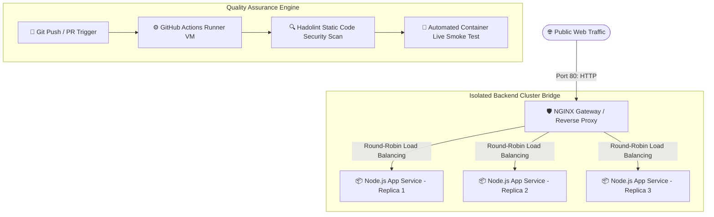

# Production-Grade Microservices Cluster & CI/CD Pipeline

A high-availability, load-balanced web architecture featuring an optimized multi-stage container cluster orchestrated by **Docker Compose**, reverse-proxied with **NGINX**, and fully validated via a **GitHub Actions CI Pipeline** [WzJqWc].

---

## 🏗️ System Architecture



---

## 🚀 Key Engineering & DevOps Highlights

* **Advanced Reverse Proxying & Load Balancing:** Configured NGINX using an explicit `upstream` group to symmetrically distribute load evenly across scaled active internal containers [WzJqWc].
* **Production-Hardened Security:** 
  * Suppressed server tokens (`server_tokens off;`) within NGINX configuration profiles to neutralize scanning signature attacks [WzJqWc].
  * Discarded root superuser execution privileges inside the `app/Dockerfile` layer (`USER node`) to align strictly with standard Principle of Least Privilege execution boundaries [WzJqWc].
* **Optimized Multi-Stage Container Layering:** Constructed high-efficiency build pipelines utilizing an initial intermediate compilation layer (`AS builder`), ensuring the final distributed image context retains a bare production profile stripped of unnecessary dependency caches [WzJqWc].
* **Proactive State Health Checks:** Configured explicit dependency conditions (`service_healthy`) mapping between architectural layers, allowing Docker engines to intercept internal errors automatically before public endpoints update routes [WzJqWc].

---

## 🔧 Local Environment Deployment & Verification

To build and spin up the multi-instance runtime topology locally on your development system, run:

```bash
# 1. Clone repository layout
git clone https://github.com
cd github-devops-portfolio

# 2. Compile system images and daemonize cluster execution
docker compose up --build -d
```

### 🧪 Live Status Verification

Confirm backend load distribution patterns via sequential terminal `curl` execution requests [WzJqWc]:

```bash
curl http://localhost
```

**Expected Return Cycle Sequences:**
```json
{"message":"Hello from the production-ready microservice cluster!","processed_by_host":"demo_backend-1", ...}
{"message":"Hello from the production-ready microservice cluster!","processed_by_host":"demo_backend-2", ...}
{"message":"Hello from the production-ready microservice cluster!","processed_by_host":"demo_backend-3", ...}
```
